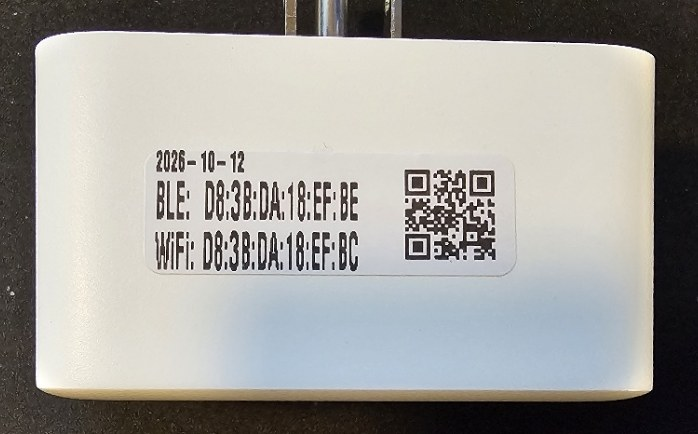

# Switchback

**Convert a SwitchBot Plug Mini to ESPHome over Wi-Fi and Bluetooth. No app, no cloud, no soldering.**

Switchback replaces the stock firmware on a SwitchBot Plug Mini (W1901400 and the HomeKit W1901401, both ESP32-C3) with [ESPHome](https://esphome.io), so the plug works locally with Home Assistant.



A converted plug with its label. `switchback label` prints one (ZPL, optional).

## What Switchback does to your network. Read this first.

The plug downloads its firmware updates over plain HTTP from `wohand.com`, SwitchBot's update host. Switchback works by **pointing that one name at your own computer** for a short time, so a plug you own downloads ESPHome instead.

To do that, Switchback:

1. Runs a small web server on your computer (port 80) that answers the plug's update requests with an open source flasher and an ESPHome image.
2. Optionally runs a tiny DNS responder (port 53) that answers `wohand.com` and `www.wohand.com` with your computer's address and forwards every other name, unchanged, to a public resolver.
3. Talks to the plug over Bluetooth to give it your Wi-Fi details and ask it to update.

It does not touch any other device, does not intercept any other name, and does not contact SwitchBot. You choose which network gets the redirect, and you remove it when you are done. [SECURITY.md](SECURITY.md) explains every network action in detail.

> [!WARNING]
> This rewrites the plug's bootloader over Wi-Fi. If the plug loses power at the wrong moment, it is bricked. The case is welded shut, so recovery means cutting it open and flashing over the serial pads. **Do not unplug a plug while it converts, and leave it powered for at least a minute after it finishes.** Try one plug before you do a box of them. There is no warranty.

## Install

You need Python 3.10 or newer and a computer with Bluetooth that [bleak](https://github.com/hbldh/bleak) supports: Windows 10 or 11, macOS, or Linux with BlueZ.

With [uv](https://docs.astral.sh/uv/):

```bash
uv tool install git+https://github.com/WiFiGUY512/switchback
```

Or with [pipx](https://pipx.pypa.io/):

```bash
pipx install git+https://github.com/WiFiGUY512/switchback
```

To pin a release, add `@v0.3.0` to the URL. There is no exe. The firmware files are not in the package: Switchback downloads them from this repository's [Releases](https://github.com/WiFiGUY512/switchback/releases) and checks each against the release's `SHA256SUMS` before it serves anything.

## Quick start

1. Check your computer:

   ```bash
   switchback check --firmware --ble
   ```

   This looks at the ports, DNS, Bluetooth and firmware, and tells you what to fix.

2. Point `wohand.com` at your computer for the plug's network (next section).

3. Plug in a stock Plug Mini near the computer and run:

   ```bash
   switchback convert
   ```

   It asks how the plug should get on Wi-Fi afterwards, and which Wi-Fi to use for the download. Then it finds the plug over Bluetooth, gives it the Wi-Fi, triggers the update and follows it to the end.

On Linux, ports 80 and 53 need root: `sudo "$(command -v switchback)" convert`. On Windows, allow the one-time firewall prompt.

## Point wohand.com at your computer

The plug takes its DNS server from DHCP. It has no setting of its own, and a `hosts` file on your computer does nothing for the plug. Pick one of these. In each, `<PC>` is the address `switchback check` prints as "This computer".

**Use the built-in DNS (simplest).** Leave Switchback's DNS on (the default) and set the **DHCP DNS server** of the network the plug joins to `<PC>`. Everything else keeps resolving normally through the forwarder. A guest or IoT network you can change on its own is ideal. Put the setting back afterwards.

**Or add two records to the DNS server you already run,** and start Switchback with `--no-dns`:

| DNS server | Where |
| --- | --- |
| Pi-hole | Local DNS Records: add `wohand.com` and `www.wohand.com` to `<PC>` |
| AdGuard Home | Filters, DNS rewrites: add `wohand.com` and `*.wohand.com` to `<PC>` |
| OPNsense / pfSense (Unbound) | Unbound DNS Overrides (OPNsense) or DNS Resolver Host Overrides (pfSense): host `www` and a blank host, domain `wohand.com`, IP `<PC>` |
| OpenWrt (dnsmasq) | Network, DHCP and DNS, Addresses: `/wohand.com/<PC>` (covers both names) |
| Technitium | Zones: add a primary zone `wohand.com` with A records for `@` and `www` to `<PC>` |
| UniFi Network | Local DNS records (the menu moves between versions): A records for both names to `<PC>` |
| MikroTik RouterOS | `/ip dns static add name=wohand.com address=<PC>` and the same for `www.wohand.com` |

Check it from a device on the plug's network:

```bash
nslookup www.wohand.com
```

The answer must be `<PC>`. Remove the records once your plugs are converted.

## Two ways to convert

### Path A: Bluetooth only (no app)

This is what `switchback convert` does, and it works on plugs whose stock firmware still accepts the Bluetooth update command.

1. Switchback finds the plug over Bluetooth and sends it the Wi-Fi name and password (the same plaintext commands the SwitchBot app uses).
2. The plug joins Wi-Fi. Switchback sends the Bluetooth update trigger.
3. The plug fetches the flasher (`app.bin`) from your computer, reboots into it, and the flasher writes the ESPHome image over the stock firmware.
4. The plug boots ESPHome.

Use a plain, flat 2.4 GHz network for the download. Stock firmware has been seen joining a VLAN-tagged network but never getting an IP address there, while the same plug worked at once on a flat network.

**Wi-Fi after conversion**, chosen with `--mode`:

- **portal** (proven, the default). The plug opens an open hotspot named `sbplug-xxxxxx`. Join it and the captive portal (`http://192.168.4.1`) asks for your Wi-Fi.
- **direct** (experimental). Switchback patches the Wi-Fi you typed into the image, so the plug joins your network by itself. The patch verifies itself, but this mode has not yet converted a real plug. If the plug cannot join, it opens the same hotspot as portal mode, so nothing is lost.

### Path B: newer stock firmware (the app re-onboard)

Newer stock firmware (seen from about v2.7) ignores the Bluetooth update trigger. Switchback detects this: the plug answers `0c` to every version byte it tries, and Switchback stops and tells you. The plug is unharmed.

What still works: a **fresh setup in the SwitchBot app still fetches firmware over plain HTTP from wohand.com**. So:

1. Point `wohand.com` at your computer (above) on the network the plug will join.
2. Run the server alone:

   ```bash
   switchback serve
   ```

3. Remove the plug from the SwitchBot app if it is there, reset it to setup mode as SwitchBot's manual describes (a long press on the button until the light flashes), then add it again in the app, on that network.
4. Watch `switchback serve`. You will see `stage1`, `flip`, `payload_md5`, `payload_start` and `payload_done` for the plug. Then it reboots into the portal image.
5. Join its `sbplug-xxxxxx` hotspot and set the Wi-Fi at `http://192.168.4.1`.

A plain "check for update" in the app does not work: that path uses SwitchBot's cloud over TLS.

## After conversion

The image Switchback writes is a small bootstrap. It has:

- the relay, the button (short press toggles, hold 10 seconds to factory reset) and the blue status LED,
- the ESPHome API **without encryption**,
- OTA with the published password **`switchbota`**.

Adopt the plug in ESPHome or Home Assistant and flash your own config over OTA right away, with your own API key and OTA password. You can build on the same hardware definition as a remote package:

```yaml
packages:
  switchback: github://WiFiGUY512/switchback/firmware/esphome/sbplug-common.yaml@v0.3.0

api:
  encryption:
    key: !secret api_encryption_key

ota:
  - platform: esphome
    password: !secret ota_password

wifi:
  ssid: !secret wifi_ssid
  password: !secret wifi_password
```

To flash a config while the plug is still in hotspot mode, join its `sbplug-xxxxxx` network and run `esphome upload your.yaml --device 192.168.4.1` (OTA password `switchbota`).

## Commands

| Command | What it does |
| --- | --- |
| `switchback check` | Ports, DNS, Bluetooth (`--ble`) and firmware (`--firmware`). Changes nothing. |
| `switchback convert` | All steps for one plug (`--count N` for more). Alias: `flash`. |
| `switchback serve` | Only the update server and DNS. For Path B, or an always-on box. |
| `switchback scan` | Lists stock Plug Minis in Bluetooth range. |
| `switchback provision` | Only sets a stock plug's Wi-Fi over Bluetooth. |
| `switchback firmware` | Downloads and verifies the firmware. `--attest` also checks GitHub attestations. |
| `switchback label` | An optional ZPL label (date, both MACs, QR). Off unless you ask. |

Useful options for `convert`:

- `--only <MAC>` picks one plug when several are in range.
- `--server http://<box>` uses a `switchback serve` running on another machine, so you can carry a laptop to the plugs.
- `--fw-byte 0D` sets the update trigger's version byte. Switchback already tries 0C, 0D and 0E.
- `--domain .lan` finds converted plugs by DNS name when mDNS cannot cross VLANs.
- `--log plugs.csv` keeps a record of converted plugs. `--printer host:9100` prints a label.
- `--payload my.bin` serves your own ESPHome factory image instead of the portal one.

Set the Wi-Fi password with the prompt or the `SWITCHBACK_WIFI_PASS` environment variable rather than `--wifi-pass`, so it stays out of your shell history.

### An always-on server

To keep the update server on a Linux box, run `switchback serve` as a service. A minimal systemd unit:

```ini
[Unit]
Description=Switchback update server
After=network-online.target

[Service]
ExecStart=/usr/local/bin/switchback serve --ip <box address>
Restart=on-failure

[Install]
WantedBy=multi-user.target
```

Then run `switchback convert --server http://<box address>` from any computer with Bluetooth.

## Where the firmware comes from

Every release is built by [GitHub Actions](.github/workflows/release.yml) from the tagged commit. Nothing is built on anyone's PC:

- `app.bin`: the flasher, built from [`firmware/flasher`](firmware/flasher) with ESP-IDF v4.4.
- `sbplug-portal.bin` and `sbplug-direct.bin`: built from [`firmware/esphome`](firmware/esphome) with a pinned ESPHome version.
- `SHA256SUMS` and a build provenance attestation for each file.

Switchback refuses any file that does not match `SHA256SUMS`. To check provenance yourself:

```bash
gh attestation verify sbplug-portal.bin -R WiFiGUY512/switchback
```

To build your own payload, see [CONTRIBUTING.md](CONTRIBUTING.md). The `sbplug-implant.yaml` variant bakes your own Wi-Fi, API key and OTA password in; serve it with `--payload`.

## Troubleshooting

- **Status 30 or 40 that loops.** The plug cannot find the network. It sees 2.4 GHz only, and the name is case sensitive. Switchback stops after about 45 seconds of this.
- **Status 50 that never turns into "connected".** The plug joined but got no IP address. Use a flat network without VLAN tagging for the download.
- **"refused the Bluetooth update trigger".** Newer stock firmware. Use Path B.
- **The plug never fetches anything.** Its DNS is not reaching your redirect, or something blocks port 80 to your computer. Run `nslookup www.wohand.com` from a device on the plug's network.
- **A port is busy.** Something else uses port 80 or 53. Stop it, or use `--no-dns` with your own DNS records, or run the server on another box.
- **Bluetooth drops on Windows.** Switchback retries the Wi-Fi step three times. Nothing has been sent to the plug when a connection fails.
- **A plug stopped mid-way.** If `switchback scan` still finds it, it is on stock firmware and unharmed. Run again.
- **It rolled back to stock.** ESP-IDF rolls an update back if the plug reboots or loses power in about its first minute. Leave plugs powered.

### Recovery

If a plug stops responding during the write, it is bricked. Recovery means opening the case and flashing over the serial pads with a 3.3 V USB serial adapter. The ESP32-C3 enters download mode when GPIO9 is held low at power on. `esptool.py` and any ESPHome factory image will bring it back.

## Legal

Switchback is not affiliated with, endorsed by or connected to SwitchBot or Wonderlabs, Inc. SwitchBot is their trademark. Only convert devices you own. Converting a plug voids its warranty and removes it from SwitchBot's cloud. You use this at your own risk.

## Credits and license

Switchback grew out of [kendallgoto/switchbota](https://github.com/kendallgoto/switchbota) by Kendall Goto, who reverse engineered the plug's OTA process and wrote the flasher this project still uses. Switchback adds the direct to ESPHome path, Bluetooth Wi-Fi provisioning without the app, release verification, and the tooling around it.

Licensed under the GNU General Public License v3.0, the same as upstream. See [COPYING](COPYING).
